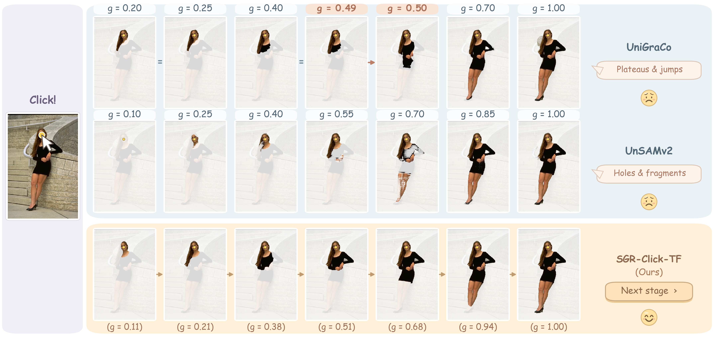
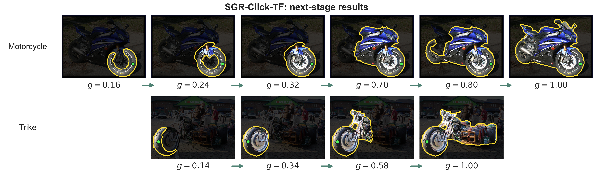
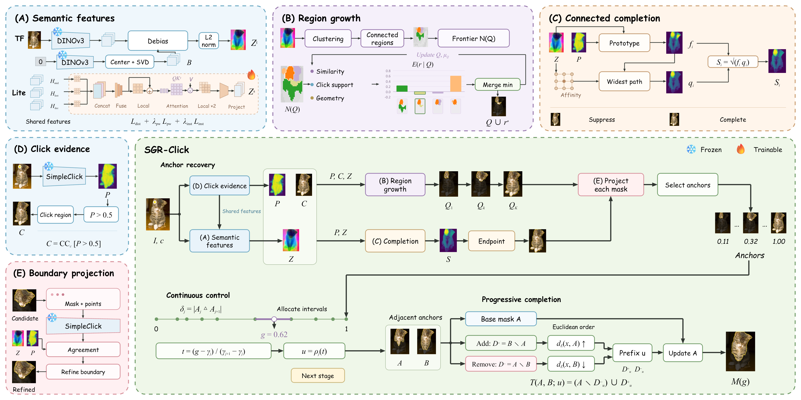

<div align="center">

# SGR-Click

### Semantic Anchors and Progressive Completion<br>for Interactive Granularity Control

**Click a part. Explore its semantic context. Select the scope you need.**

[Overview](#overview) · [Models](#models) · [Quick start](#quick-start) · [Evaluation](#evaluation) · [Documentation](#documentation)

</div>



**One click can refer to different parts of the same object.** SGR-Click makes
that choice explicit: it recovers representative **semantic anchors**, then
connects them with a progressively changing mask path. Move the granularity
slider to explore the path, or press **Next stage** to select the next anchor.

## Overview

What should happen as segmentation granularity increases? Our view is that the
mask should progress toward broader semantic scopes around the clicked target,
with gradual spatial changes between them. SGR-Click gives the control
`g ∈ [0, 1]` this interpretation: **progress along a semantic recovery path**.

- **Semantic stages.** Recover representative scopes from click-conditioned
  foreground evidence and image semantics.
- **Continuous adjustment.** Connect neighboring anchors through an explicit
  pixel update order, so intermediate masks can be explored with one slider.
- **Direct selection.** Navigate anchors with **Previous stage / Next stage**,
  then refine the selected mask with positive and negative clicks.
- **Two models, one interaction.** Choose a training-free semantic extractor
  or a lightweight trained head that shares the interaction backbone.

### From a wheel to the vehicle



Each step selects a recovered anchor and displays its corresponding `g`.
The slider also provides the intermediate masks between these stages.
Anchor locations are determined for the image and click, so the same `g`
does not denote a fixed part category across images.

### How it works



1. **Recover semantic anchors.** Combine the initial click prediction with
   semantic features to grow candidate regions and recover a broader endpoint.
2. **Refine and select.** Project candidates to image boundaries using the
   interaction model, then retain representative masks as anchors.
3. **Build the path.** Assign anchors positions on the granularity axis and
   progressively update the differing pixels between neighboring anchors.
   Both models use Euclidean distance to determine this spatial order.

## Models

Both variants use a frozen **SimpleClick ViT-B** interaction backbone.

| Model | Semantic feature extractor | Semantic module | Total parameters | Additional training |
| :--- | :--- | ---: | ---: | :--- |
| **SGR-Click-TF** | Pretrained DINOv3 ViT-L/16 | 303.15M | 401.18M | None |
| **SGR-Click-Lite** | Head over shared backbone features | 2.41M | 100.43M | Semantic head only |

**Lite replaces the separate DINOv3 encoder with a 2.41M-parameter head.**
It requires no DINOv3 model at inference and reduces total parameters by about
75% relative to TF. Its trained head is included in this repository, so either
variant can be used directly after preparing the required pretrained weights.

## Quick start

### 1. Install

Use **Python 3.10** in a separate environment.

```bash
git clone --branch v1.0 https://github.com/2jiachens/SGR-Click.git
cd SGR-Click
python -m venv .venv
```

Activate the environment:

```bash
# Linux / macOS
source .venv/bin/activate

# Windows PowerShell
.venv\Scripts\Activate.ps1
```

Install a compatible PyTorch / torchvision pair for your device using the
[official installer instructions](https://pytorch.org/get-started/locally/), then:

```bash
python -m pip install --upgrade pip
python -m pip install -e .
```

See the [tested environment](docs/environment.md) for dependency versions.
The desktop demo needs Tkinter (`python3-tk` on Ubuntu).
Use a separate environment from UniGraCo because both retain the upstream
`isegm` package namespace.

### 2. Prepare weights

| Weight | Lite | TF | Source |
| :--- | :---: | :---: | :--- |
| SimpleClick COCO+LVIS ViT-B | Required | Required | [Official model release](https://github.com/uncbiag/SimpleClick#model-weights) |
| SGR-Click Lite semantic head | Required | — | [Included](checkpoints/sgr_click_lite.pt) |
| DINOv3 ViT-L/16 | — | Required | [Official pretrained models](https://github.com/facebookresearch/dinov3#pretrained-models) |

For **Lite**, place the downloaded `cocolvis_vit_base.pth` in `checkpoints/`:

```text
checkpoints/
├── cocolvis_vit_base.pth
├── sgr_click_lite.pt       # already included
└── manifest.json
```

```bash
python scripts/verify_weights.py --model lite
```

For **TF**, follow the [weight preparation guide](docs/weights.md) to add the
DINOv3 source and checkpoint. The guide includes exact filenames, source
revision, and SHA-256 verification.

### 3. Launch the demo

```bash
sgr-click demo --model lite

# After preparing DINOv3:
sgr-click demo --model tf
```

Open an image, click the target, and explore its semantic scopes:

| Control | Action |
| :--- | :--- |
| First left-click | Establish a recovery path around the target |
| Granularity slider | Explore masks along the path |
| Previous stage / Next stage | Select a semantic anchor directly |
| Additional left-click / right-click | Add a positive / negative correction |
| Undo | Restore the preceding interaction state |

Commands use `cuda:0` by default. Add `--device cpu` to run on CPU, or
`--device cuda:1` to select another GPU. Custom checkpoint locations are
supported through `--backbone`, `--student`, `--dino-repo`, and `--dino-weights`.

## Image inference

Export a mask at the requested granularity from one positive click:

```bash
sgr-click predict --model lite --image image.jpg --click 240 160 --granularity 0.6 --output outputs/example
```

Click coordinates are `(x, y)` in the input image. The output folder contains:

| File | Contents |
| :--- | :--- |
| `mask.png` | Binary mask at the requested `g` |
| `anchors.npz` | Recovered anchor masks and their granularity values |
| `prediction.json` | Model, click, selected `g`, and anchor positions |

<details>
<summary><strong>Python API</strong></summary>

```python
import numpy as np
from PIL import Image
from sgr_click.model import ModelPaths, build_model

image = np.asarray(Image.open("image.jpg").convert("RGB")).copy()
controller, provider = build_model(
    "lite",
    ModelPaths(
        backbone="checkpoints/cocolvis_vit_base.pth",
        student="checkpoints/sgr_click_lite.pt",
    ),
)
try:
    controller.set_image(image)
    controller.set_granularity(0.0)
    controller.add_click(240, 160, True)
    controller.set_granularity(0.6)
    mask = controller.current_object_prob > 0.5
    Image.fromarray(mask.astype("uint8") * 255).save("mask.png")
finally:
    provider.close()
```

</details>

## Evaluation

The release includes reproducible evaluation for **both TF and Lite**.
Demo, inference, and evaluation share the same model construction.
First set dataset locations in [`configs/datasets.yaml`](configs/datasets.yaml).

| Evaluation | What it measures | Datasets |
| :--- | :--- | :--- |
| Semantic coverage and ordering | mBIoU and SOR | Pascal-Part, PartImageNet, SPIN |
| Granularity response | Stagnation and abrupt changes (SWR / JSR) | Same semantic benchmarks |
| Interactive correction | NoC@85 / NoC@90 | GrabCut, Berkeley, DAVIS, SBD, Pascal VOC, Pascal-Part, PartImageNet |

Run a single dataset:

```bash
sgr-evaluate semantic --model lite --dataset PascalPart --split remaining --output outputs/lite/semantic/pascalpart
sgr-evaluate noc --model lite --dataset GrabCut --protocol both --output outputs/lite/noc/grabcut
```

Run all configured datasets:

```bash
python scripts/evaluate_all.py --task semantic --model lite
python scripts/evaluate_all.py --task noc --model lite
```

Replace `lite` with `tf` to evaluate the training-free model. NoC supports the
ten-branch and best-first-101 **GT-assisted oracle** protocols; these evaluate
automated scope selection and correction rather than human interaction time.

The [evaluation guide](docs/evaluation.md) specifies dataset preparation, sample
splits, metric definitions, and aggregation commands. Runs save per-target
records and reproducibility manifests, support disjoint shards, and resume
with matching settings. Add `--limit 1` to a single-dataset command for a smoke
test before launching a full evaluation.

## Documentation

| Guide | Contents |
| :--- | :--- |
| [Environment](docs/environment.md) | Tested dependencies and device setup |
| [Weights](docs/weights.md) | Downloads, DINOv3 setup, and checksums |
| [Evaluation](docs/evaluation.md) | Datasets, protocols, metrics, and result summaries |
| [Validation](docs/validation.md) | Release checks and real-image regression verification |
| [Third-party notices](THIRD_PARTY.md) | Source attribution and license boundaries |

<details>
<summary><strong>Repository structure and development checks</strong></summary>

```text
assets/                Method figures and qualitative examples
checkpoints/           Released Lite head and weight manifest
configs/               Dataset path configuration
docs/                  Setup and reproduction guides
scripts/               Weight verification and batch evaluation
src/
  sgr_click/           Models, mask paths, desktop demo, and evaluation
  isegm/               SimpleClick backbone compatibility code
tests/                 Path, cache, data, and protocol checks
```

```bash
python -m pip install -e ".[dev]"
python -m pytest -q
```

Unit tests use synthetic inputs and require no model downloads.

</details>

## Acknowledgments

SGR-Click builds on [SimpleClick](https://github.com/uncbiag/SimpleClick) and
[DINOv3](https://github.com/facebookresearch/dinov3). We also thank
[UniGraCo](https://github.com/Zhao-Yian/UniGraCo) for its released click simulator
and ten-branch NoC evaluation implementation, and
[UnSAMv2](https://github.com/yujunwei04/UnSAMv2) for its comparison code.

Please see [LICENSE](LICENSE), [THIRD_PARTY.md](THIRD_PARTY.md), and the upstream
model terms for the licenses applicable to the code and pretrained weights.
